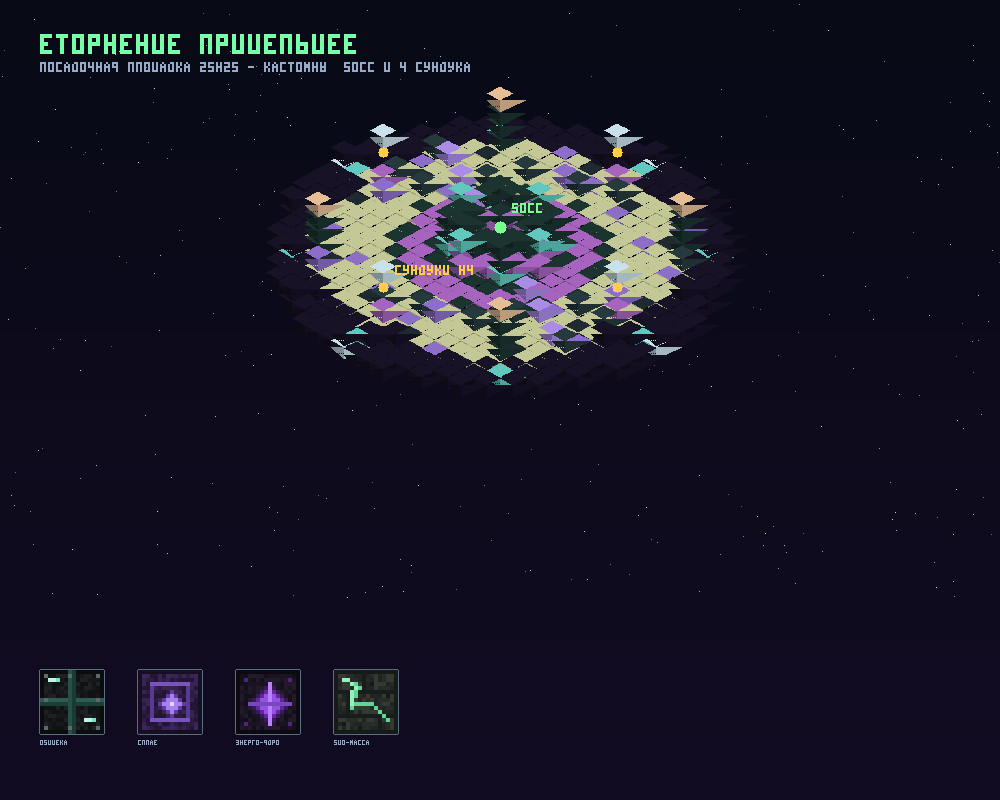

# 🛸 GeyserEvent v1.20.0 — 5 анархических ивентов для Purpur 26.2

Плагин с **четырьмя временными ивентами** («Адский Разлом», «Пляжные Раскопки», «Котёл Алхимика»,
**«Вторжение Пришельцев»**) и **постоянным ивентом** «Шахта Древних (Жила Жеод)»
на координатах **`0 ~ 0`** мира `world2`.
Создан специально для анархии на ядре **Purpur 26.2** с полной поддержкой игроков
**Bedrock Edition (GeyserMC / Floodgate)** — и с телефонов, и с Bedrock ПК.

> 💰 **За топ-3 по урону босса дают осколки:** 1 место — **1500**, 2 место — **100**, 3 место — **500** (настраивается в `config.yml` → `rewards`).
> ❌ Плагин **не трогает Scoreboard** сервера. ❌ Названий плагинов в текстах для игроков нет.

---

## 📥 Быстрое скачивание

| Файл | Прямая ссылка |
|---|---|
| **Плагин `GeyserEvent-1.0.0.jar` (v1.20.0)** | https://github.com/gulp-tech/GeyserEvent/raw/arena/f52450bb-geyserevent/GeyserEvent-1.0.0.jar |
| **Ресурспак `GeyserEvent-Pack.mcpack` (v1.20.0)** | https://github.com/gulp-tech/GeyserEvent/raw/arena/f52450bb-geyserevent/GeyserEvent-Pack.mcpack |
| **Меню DeluxeMenus `events.yml` (`/events`)** | https://github.com/gulp-tech/GeyserEvent/raw/arena/f52450bb-geyserevent/deluxemenus/events.yml |
| **Релиз v1.20.0** | https://github.com/gulp-tech/GeyserEvent/releases/tag/v1.20.0 |

Ресурспак встроен внутрь плагина и **автоматически перезаписывается** в `plugins/Geyser-Spigot/packs/`
при запуске сервера (в `onLoad()`), поэтому старый тектурпак/модель рюкзака заменяются сами.

---

## 🎮 Ивенты

### 1. «Адский Разлом (Вторжение Босса)»
- Цитадель Разлома **15×15**, портал **не телепортирует** игроков, полный откат terrain.
- **2-метровый Piglin Brute**: 3500 HP, **8 урона**, незеритовый топор, таймаут **20 минут**.
- Способности в радиусе **15 блоков**: притягивание, отталкивание, стяжка всех в одну точку.
- **Тихий** спавн приспешников (до 20 блоков), деградирующий лут, **без сообщений в чат**.
-Топ-3 по урону по завершении — **осколки**: 1 место **1500**, 2 место **100**, 3 место **500**.
- **Босс никогда не становится бессмертным** и **всегда мгновенно исчезает** после смерти
  или окончания ивента (даже если чанки выгружены): чанки ивента удерживаются загруженными,
  сущности принудительно удаляются, `setPersistent(false)`.

### 2. «Пляжные Раскопки»
- Большая схема **31×31** (`beach_excavation.schem.yml`), 8 пальм, 4 лагеря, центральный подиум,
  150+ блоков подозрительного песка, полный откат terrain.
- **2-метровый Житель-Археолог** на подиуме готовит кисточку (`обычная` / `эпическая` / `легендарная`
  с весами **35% / 40% / 25%**), забирается по клику.
- Кисточки выпадают на пол, максимум **3** в инвентаре, мгновенно исчезают при выходе из зоны
  **16.5** блоков или при выходе с сервера, блокируют `/ah sell` и `/ah sellinv`, копка **без спама в чат**.

### 3. «Котёл Алхимика»
- Улучшенная схема **31×31** (`alchemist_cauldron.schem.yml`, `schema-version: 2`): готическая ротонда
  с куполом, 4 входа-арки, 4 алхимических павильона, 4 светящиеся реки, 16 пьедестов с реагентами,
  полный откат terrain.
- Периодический рост нестабильных реагентов 3 редкостей (`Обычный` / `Эпический` / `Легендарный`)
  с лёгкими частицами; максимум **3** в инвентаре, эффект `Glowing` при ношении, исчезают при выходе
  из зоны **16.5** блоков или при выходе с сервера, блокируют `/ah sell` и `/ah sellinv`.
- Сдаются Алхимику у котла, лут настраивается через `/cauldronmenu`.

### 4. «Вторжение Пришельцев» 🛸 — кастомный босс, своя текстура и 4 сундука



- Красивая схема-посадка **25×25** (`alien_landing.schem.yml`, 607 блоков): капсула корабля
  в центре, био-зона с бионитами и кристаллами, **4 пьедестала** и **4 антенны** со светом
  на вершинах, посадочное кольцо с рунами и огнями — полный откат terrain.
- **Кастомный босс-пришелец** (по умолчанию Эвокер с перекрашенной в ресурспаке текстурой):
  **2500 HP**, **9 урона**, размер **1.25**, фазы на **50%** и **20%** (ускорение, молния,
  стяжка всех в одну точку), иммунитет к урону окружения, имя и HP в **BossBar сверху**.
- **Малые пришельцы** (по умолчанию Векс, тоже с кастомной текстурой) прилетают волнами
  каждые **25 секунд**, максимум **8** штук, а чем меньше остаётся HP у босса,
  тем чаще он зовёт подкрепление.
- **После убийства босса открываются 4 сундука с ресурсами** на пьедесталах: алмазы, изумруды,
  незеритовые слитки, золото, флаконы опыта, аметистовые осколки (лут настраивается).
- Топ-3 по урону получают осколки (общий раздел `rewards` в `config.yml`).
- Запуск: `/rift start alien`, `/rift start-here alien` или автоматически в ротации ивентов.
  Остановка: `/rift stop`. Статус: `/rift status`, `/event delay`.

### 5. «Шахта Древних (Жила Жеод)» — постоянный ивент на `0 ~ 0`
- Цельная схема карьера **45×45** (`ancient_mine.schem.yml`, радиус 22, зона **24.5** блока),
  автоматически ставится на `0 ~ 0` в `world2`, с полным бэкапом и откатом terrain,
  правильной крышей, цельными жилами руд и **нулём висящих блоков**.
- **БоссБара у шахты нет** — в чат пишется сообщение, когда жила обновляется.
- Руда и жеоды **падают на пол** (и при смерти игрока все добытые руды/жеоды тоже падают на пол).
- **Шахтёрский рюкзак** (`GeyserEvent-Pack.mcpack`, 3D-модель на спине, `DY = -29.0`, не мешает броне),
  уровни **1→6**: `15 → 30 → 50 → 75 → 110 → 160`.
- **Древний Кузнец** всегда открывает свою кузницу и рюкзак (никакого ванильного `Оружейник : Мастер`),
  даёт слитки/кристаллы и очки кузницы — **без осколков**.

---

## 🧩 Куда плагин кладёт ресурспак (любой способ запуска Bedrock-движка)

3D-рюкзак шахтёра и блоки призыва работают только если Bedrock-игроки получают ресурспак
`GeyserEvent-Pack.mcpack`. Плагин при каждом запуске сам ищет папку packs и копирует пак
**во все найденные** места, в таком порядке:

1. `resourcepack.geyser-packs-dir` из конфига — если путь указан явно, используется только он;
2. **`<папка сервера>/bedrock/packs`** — Bedrock-движок, встроенный в ядро (Purpurbedrock и сборки с встроенным Geyser);
3. `-Dpurpurbedrock.dataDir=<...>/packs` — если движку задан свой каталог данных;
4. `plugins/Geyser-Spigot/packs` — плагин Geyser-Spigot на этом же сервере;
5. `plugins/Geyser/packs` и `<папка сервера>/geyser/packs`.

Если ничего не найдено — плагин создаёт `<папка сервера>/bedrock/packs` и кладёт пак туда,
а в консоль пишет крупную подсказку, куда скопировать файл вручную.

**При каждом запуске в консоль пишется диагностика:**

Папки в корне сервера (/home/minecraft/server): bedrock, cache, config, libraries, logs, plugins, world, world2
Папки packs Bedrock-движка (проверяются):
   • /home/minecraft/server/bedrock/packs  [есть]
Ресурспак ивентов скопирован: /home/minecraft/server/bedrock/packs/GeyserEvent-Pack.mcpack
```
По этим строкам сразу видно, нашлась ли папка packs и доехал ли пак. Если после этого
Bedrock-игроки всё равно не получают пак — проверьте в клиенте **Настройки → Глобальные ресурсы**
(в списке должен быть «GeyserEvent Pack» и быть активным).

### Пак регистрируется прямо в движке Bedrock (v1.9.15)

Одной папки `packs` может быть недостаточно: движок читает её один раз при старте.
Поэтому плагин **дополнительно подписывается на события загрузки паков Geyser API**
(`GeyserDefineResourcePacksEvent` / `GeyserLoadResourcePacksEvent`) и сам добавляет свой пак
в список отправляемых Bedrock-игрокам. В консоли при старте появятся строки:

```
Движок Bedrock сообщил свою папку packs: C:\...\bedrock\packs
Ресурспак ивентов передан движку Bedrock через Geyser API — он будет отправляться Bedrock-игрокам.
Паки, которые движок Bedrock отправляет игрокам (2): GeyserEvent Pack v1.60, ...
```

Последняя строка показывает, какие паки реально уходят клиентам — если «GeyserEvent Pack»
там есть, доставка работает.

**Что плагин рисует на экране (v1.9.29):** только информацию ивента — босс-бар сверху экрана
и GPS-строку в action bar (компас и координаты). Панель в правом верхнем углу убрана по
просьбе игрока — ресурспак больше не меняет HUD клиента вообще (только рюкзак и блоки призыва).


Узнать точную рабочую папку сервера на Linux:

```bash
PID=$(pgrep -f 'purpurbedrock-26.2.jar' | head -1)
readlink -f "/proc/$PID/cwd"      # к результату добавить /bedrock/packs
```

**Важно:** движок читает папку packs при старте. Если пак скопирован плагином уже после
старта движка — **перезапустите сервер ещё раз** и перезайдите в игру Bedrock-клиентом.

## 🧩 Если Geyser стоит отдельным прокси (Purpur + Geyser Standalone/BungeeCord/Velocity)

3D-рюкзак шахтёра и блоки призыва работают только если Bedrock-игроки получают ресурспак
`GeyserEvent-Pack.mcpack`. Плагин сам кладёт его в папку **packs** вашего Geyser:

- Geyser-Spigot плагином на этом же сервере → папка находится сама (`plugins/Geyser-Spigot/packs`);
- Geyser отдельным прокси → укажите путь к его папке packs в конфиге:

```yaml
resourcepack:
  auto-install-to-geyser: true
  geyser-packs-dir: "/home/geyser/packs"   # путь к packs вашего Geyser
```

Если путь недоступен с сервера (Geyser на другой машине), плагин при запуске напишет в консоль
точный файл и куда его скопировать вручную:
`plugins/GeyserEvent/resourcepack/GeyserEvent-Pack.mcpack` → `<папка packs Geyser>/`.
После копирования **перезапустите Geyser** и перезайдите в игру.

Проверить всё это можно командой **`/rift hudinfo`** — она показывает путь до пака,
результат копирования, ваш клиент (Bedrock/Java) и идёт ли ивент.

## 🔍 Проверка ресурспака (рюкзак шахтёра и блоки призыва)

Пак нужен только для 3D-рюкзака на спине и красивых текстур блоков призыва.
Информацию ивента плагин больше не рисует в углу экрана — только босс-бар сверху
и GPS в action bar, поэтому проверять пак нужно только если нет рюкзака или блоков призыва.

- **`/rift hudinfo`** — диагностика: ваш клиент (Bedrock/Java), найден ли API Geyser/Floodgate,
  лежит ли ресурспак в папке packs, идёт ли ивент сейчас.

Если ресурспак не применился: перезапустите сервер (плагин кладёт пак сам при старте) и
перезайдите в игру — Bedrock скачает новую версию пака (v1.19.0). Проверить можно
в настройках клиента: **Настройки → Глобальные ресурсы** — в списке должен быть
«GeyserEvent Pack» и он должен быть активным (и стоять версия **1.19.0**; если версия
старая — удалите пак из списка и перезайдите, сервер пришлёт его заново).

## 🆕 Что нового в v1.20.0 (ивент «Вторжение Пришельцев»)
- **Новый ивент с кастомным боссом**: «Вторжение Пришельцев» — посадочная площадка 25×25,
  босс-пришелец с кастомной текстурой, малые пришельцы и **4 сундука с ресурсами** после убийства.
- **Кастомные текстуры** (`GeyserEvent-Pack.mcpack` v1.20.0): 4 блока корабля
  (обшивка / сплав / энерго-ядро / био-масса) + перекраска Эвокера и Векса под пришельцев.
  Блоки подобраны так, что они **не встречаются в схемах других ивентов**, поэтому
  «Адский Разлом», «Раскопки» и «Котёл» выглядят точно как раньше.
- Все настройки — в `config.yml` → секция **`alien`**: тип и статы босса, тип и статы
  приспешников, интервал способностей, смещения сундуков, лут, тайминги и сообщения.
- `/event delay`, `/rift status`, `/rift stop` и `/rift start alien` умеют работать с новым ивентом,
  GPS-локатор (`/event gps`) ведёт к самому пришельцу.
- Пак получает **новый UUID** (каждую версию), поэтому клиенты Bedrock перекачивают его сами.

## 🆕 Что нового в v1.9.29 (панель ивента убрана — остался только BossBar сверху + GPS)

1. **Панель в правом верхнем углу экрана полностью убрана** по просьбе игрока
   (она рисовала моланг-выражения текстом вместо данных). Возврат к ней — «позже сделаем».
2. **Action bar теперь только для GPS** — плагин больше не присылает туда никаких служебных строк.
3. **Ресурспак больше не меняет HUD клиента**: из пака удалён `ui/hud_screen.json`,
   остались только рюкзак шахтёра и текстуры блоков призыва (13 файлов).
4. **На экране остаётся:** BossBar сверху со статусом ивента и GPS-локатор (`/event gps`) — стрелка, дистанция и координаты.
5. Команды `/rift hudtest` больше нет; `/rift hudinfo` остался как диагностика ресурспака.

---

## 🆕 Что было в v1.9.24–v1.9.28 (панель в углу экрана)

> ⚠️ Всё, что описано ниже в этих разделах — история разработки. **В v1.9.29 панель убрана**,
> см. раздел «Что нового в v1.9.29» выше.


## 🆕 Что нового в v1.9.25 (призывные ивенты: алтарь призыва босса)

Босса можно призвать вручную — через **алтарь из специальных блоков с кастомными текстурами**.

**1. Структура (5 блоков, у каждого своя текстура 16×16, ~1 КБ на все):**

| Блок | Базовый блок | Текстура |
|---|---|---|
| Алтарь (центр) | `REINFORCED_DEEPSLATE` | тёмный камень + светящаяся красная руна |
| Пилон 1 | `OCHRE_FROGLIGHT` | чёрный камень + огненные трещины |
| Пилон 2 | `VERDANT_FROGLIGHT` | зелёные прожилки |
| Пилон 3 | `PEARLESCENT_FROGLIGHT` | фиолетовые прожилки |
| Пилон 4 | `BUDDING_AMETHYST` | аметистовая глыба |

Блоки выбраны редкие, поэтому обычные постройки игроков не меняются (заменить блоки можно в `config.yml` → `summon.*-block`).

**2. Как призвать:**
```bash
/rift summonaltar          # алтарь появится туда, куда смотрит админ (+4 пилона)
/rift summonaltar 100 64 200 pvp   # или по координатам
/rift givesummon           # выдать предмет-призывалку игроку
/rift summonlist           # список алтарей
/rift summonremove         # удалить все алтари
```
Потом любой игрок жмёт **ПКМ по алтарю** → начинается отсчёт, и через 2 минуты на этом месте стартует обычный «Адский Разлом» (с наградами 1500/100/500).
Во время ожидания в чат пишутся сообщения **ПРИЗЫВ БОССА / Босс появится через · 01:59 / Координаты**, а после старта ивента включается GPS.

**3. Защита от «призвали и бросили» (всё в конфиге `summon:`):**

| Правило | Ключ По умолчанию |
|---|---|
| Призыв работает только в указанном мире (ваш PvP-мир) | `summon.world: "pvp"` |
| Если рядом никого нет — призыв/ивент отменяется | `summon.player-radius: 40`, `summon.idle-no-players-seconds: 60` |
| Если босса не бьют — ивент отменяется | `summon.idle-no-damage-seconds: 90` |
| Если босса не убить — он исчезает с сообщением | `summon.boss-timeout-seconds: 300`, `summon.timeout-message` |
| Алтарь **не выпадает** предметом при срыве призыва | `summon.drop-altar-on-fail: false` |
| Сломать блоки алтаря нельзя (только `/rift summonremove`) | всегда |

## 🆕 Что нового в v1.9.24 (панель тремя строками + осколки за топ-3)

1. **Панель больше не слипается в одну строку.** Bedrock-клиент обрезает текст action bar
   на `\n` и не переносит строки, поэтому теперь плагин присылает **короткие данные**,
   а расставляет их по строкам сам ресурспак:
   | Строка | Что на ней |
   |---|---|---|
   | 1 | **название ивента** (`АДСКИЙ РАЗЛОМ` / `ПЛЯЖНЫЕ РАСКОПКИ` / `КОТЁЛ АЛХИМИКА`) |
   | 2 | **состояние и время**: `❤ 3500/3500 · 19:55`, `Кисточка: Готова · 19:55`, `Реагенты: 5 · 19:55` |
   | 3 | **координаты**: `Координаты: 100 50 200` |
2. **Иконка-«яйцо» убрана.** Текстуры `icon_*.png` удалены из пака — панель это
   чистый текст на ванильном фоне `hud_tip_text_background`.
3. **Пробелы больше не пропадают.** В v1.14.0 выражение пака вычитало пробел как один символ
   и выкидывало его везде (`АДСКИЙРАЗЛОМ·❤ 3500/3500`). Теперь разделители ставятся точно: `  ·  `.
4. **Вернулись осколки за топ-3 по урону босса** (Адский Разлом, когда босс побеждён):
   | Место | Награда |
   |---|---|
   | 🥇 1 место | **1500** осколков |
   | 🥈 2 место | **100** осколков |
   | 🥉 3 место | **500** осколков |

   Выдача идёт через **PlayerPoints** (если плагин установлен), иначе — командой
   `points give %player% %amount%`. Суммы и способ выдачи меняются в `config.yml`:
   ```yaml
   rewards:
     currency-name: "осколков"
     use-playerpoints-api: true
     fallback-command: "points give %player% %amount%"
     places:
       1: 1500
       2: 100
       3: 500
   ```
5. **Пример поля данных:** `#GE_R#|19:55~|3500/3500~|100 50 200` (маркер | время | состояние | координаты).
   Внутри полей символ `~` не используется — он нужен паку как защита от неверного разбора.
   Сам маркер из текста убирается и на экран не попадает.

**Проверить:** `/rift hudtest` — на 15 секунд показывает панель с тремя строками, даже если ивент не идёт.


## 🆕 Что нового в v1.9.23 (красивая панель, без BossBar и без сырого маркера)

1. **BossBar ивента убран полностью** — функция удалена из плагина, даже если в старом
   `config.yml` осталось `bossbar: true`, полоска больше не появится.
2. **Сырой маркер `#GE_E# …` больше не виден внизу экрана.** Ванильная строка action bar
   показывается только когда маркера ивента нет (её `alpha` уводится в 0 на время ивента),
   поэтому сообщения других плагинов работают как раньше.
3. **Панель стала карточкой:** ванильный фон `textures/ui/hud_tip_text_background`
   (та же «таблетка», что у подсказок Minecraft), иконка ивента слева, две строки —
   `иконка · название · состояние · таймер` и `Координаты: X Y Z`.
4. Иконки рисовал ресурспак — **это убрано в v1.9.24** (пользователь: «что за яйцо рядом сними»); панель теперь только текст.

## 🆕 Что нового в v1.9.22 (иконки ивентов рисует ресурспак + координаты на второй строке)

Панель в правом верхнем углу перестала быть «одной слипшейся строкой»:

1. **Иконки ивентов тогда рисовал сам ресурспак**, а не символы текста: символы
   на разных клиентах выглядят по-разному и «плывут», а текстуры пака — всегда
   одинаково (`textures/geyserevent/icon_rift.png`, `icon_excavation.png`,
   `icon_cauldron.png`). **В v1.9.24 эти текстуры удалены** — панель теперь только текст.
2. **Координаты уехали на вторую строку.** Теперь панель — это две строки:
   - первая: `иконка · название ивента · состояние · таймер`;
   - вторая: `Координаты: X Y Z`.
3. **Больше ничего лишнего:** диагностическая надпись пака убрана, BossBar выключен
   по умолчанию, родной action bar над хотбаром спрятан, пока ивент идёт.
4. Плагин по-прежнему присылает **одну строку action bar в секунду** с маркером ивента
   (`#GE_R#` / `#GE_E#` / `#GE_C#`) — ресурспак по маркеру узнаёт ивент, рисует нужную иконку
   и убирает маркер из текста.

## 🆕 Что нового в v1.9.10 (панель ивента в углу экрана + иконки ивентов)

Когда ивент начинается, в **правом верхнем углу экрана** появляется панель с его состоянием
(как на скриншоте с «Мирной посылкой»), а у каждого ивента — **своя иконка**:

| Ивент | Иконка (рисует ресурспак) | Что в панели |
|---|---|---|
| «Адский Разлом» | 💀 | HP босса, остаток времени, координаты |
| «Пляжные Раскопки» | ⚓ | готовность кисточки, остаток времени, координаты |
| «Котёл Алхимика» | ⚗ | число реагентов, остаток времени, координаты |
| «Шахта Древних» | ⛏ | иконка в чат-сообщениях об обновлении жилы |

> С v1.9.24 панель без иконок вообще — только текст на ванильном фоне.
> Символы `icon-*` в `config.yml` остаются для чат-сообщений ивентов.

**Как это сделано (и почему не лагает):**
- Панель рисует **ресурспак** `GeyserEvent-Pack.mcpack` (v1.17.0) — он добавляет свой элемент
  HUD в правый верхний угол экрана и работает через JSON-UI «добавлением» элемента,
  поэтому **никакие BossBar'u и родной HUD не ломаются** и не пропадают.
- Плагин раз в секунду присылает Bedrock-игрокам одну строку (`action bar`) со служебным
  маркером ивента: ресурспак по маркеру прячет обычный action bar и рисует панель в углу
  (с v1.9.24 — три строки без иконки, на ванильном фоне).
  **Это один пакет на игрока в секунду** — нулевая нагрузка на клиент и TPS.
- Java-игроки видят ту же информацию сообщениями в чат — как и раньше.
- Плагин **не трогает Scoreboard** игроков, поэтому скорборд- HUD сервера не конфликтует.
- На время сообщений о способностях босса панель на 2.5 секунды уступает место,
  чтобы «Босс притянул вас к себе!» не пропадало мгновенно.
- Иконки настраиваются в `config.yml` → `resourcepack.top-right-hud.icon-*`
  (`☠` / `⚓` / `⚗` / `⛏`), панель целиком выключается `top-right-hud.enabled: false`.

## 🆕 Что нового в v1.9.9 (никаких лагов при варпе/телепорте)

Отдельно под жалобу «**тепнулся на `/warp pvp`, там стоял игрок — лагнуло и у меня, и у него**».
Телепортация гоняет за собой пачку загрузок чанков, а каждый телепорт рядом с ивентом
запускал тяжёлые проходы по сущностям/чанкам. Исправлено:

1. **Поиск ивентоcных сущностей теперь фильтруется по типу раньше, чем читает данные.**
   `purgeStaleEventEntities` вызывается при каждой загрузке чанков с сущностями — то есть при
   каждом варпе. Раньше он лез в персональные данные (`PDC`) **каждой** загруженной сущности
   (в толпе у `/warp pvp` это сотни обращений к NBT). Теперь в очередь попадают только
   Жители, Пиглины-бруты и наш тип приспешника — читать `PDC` и то не нужно в 99% случаев.
2. **Древний Кузнец больше не сканирует 25 чанков «по счётчику вызовов».** Полная очистка
   территории идёт строго раз в 15 секунд по таймеру, а вызовы из телепортов/смены мира
   (`verifyBlacksmithFromEvent`) — не чаще раза в 2 секунды. На людном спавне десятки
   телепортаций в секунду больше не могут запустить серию сканов чанков.
3. **Рюкзак шахтёра — только для тех, кто добыл руду.** Раньше 3D-стойка с кастомной моделью
   создавалась **каждому** игроку в зоне шахты (а зона радиуса 24.5 накрывает точки варпа) —
   это лишние кастомные сущности для рендера всех клиентов вокруг. Теперь рюкзак виден
   только при `добыто > 0`.
4. **Проверки из `PlayerMoveEvent` стали дешевле**: снятие рюкзака не выполняется, когда его
   и не было; синхронизация рюкзака из движения троттлится до 5 раз в секунду (главный тик
   и так обновляет рюкзаки раз в 10 тиков); вместо `player.getPassengers()` (создаёт список
   на каждый вызов) используется `stand.getVehicle()`.

Итог: загрузка чанков при варпе не тянет за собой ни сканов всех сущностей, ни сканов
25 чанков, ни лишних кастомных моделей на спине — **FPS и TPS не падают**, и у телепортирующегося,
и у тех, кто уже стоит в этой точке.

## 🆕 Что нового в v1.9.8 (анти-просадки FPS)

1. **Частицы «только для своего игрока»** — эффекты добычи руды/жеод, раскопки песка и сбора
   реагентов теперь видит только сам игрок (`player.spawnParticle`), а не все окружающие.
   При 20 шахтёрах в карьере частиц на клиентах становится в 20 раз меньше.
2. **Линии способностей босса персональные** — линия притягивания и линия стяжки рисуются
   только для того игрока, по которому она идёт (раньше все линии видели все игроки рядом).
3. **Урезаны самые тяжёлые всплески частиц**: ударная волна (~240 → ~90 частиц),
   портал стяжки (90 → 40), аура притягивания (45 → 22), спавн приспешников (25+15 → 12+8),
   линии частиц стали реже (шаг 0.45 → 0.7). Визуал сохранён, нагрузка на клиент — ниже.
4. Вместе с v1.9.7 это даёт: **никаких сканов всех предметов сервера, никаких сканов 25 чанков
   каждую секунду, никакого шейдера контура (`setGlowing`) на НПС и Боссе, никаких лишних
   проверок инвентаря 20 раз в секунду.**

## 🆕 Что нового в v1.9.7 (большая оптимизация)

1. **Невидимость не работает на НПС** (как и в v1.9.6, но теперь без нагрузки):
   - Босс и Приспешники всегда наводятся на ближайшего игрока, даже невидимого.
   - Пока идёт временный ивент, зелье невидимости снимается с игроков внутри зоны ивента.
   - НПС (Босс, Приспешники, Археолог, Алхимик, Древний Кузнец) не могут стать невидимыми.
   - Настройки: `npcs.ignore-invisibility`, `npcs.strip-invisibility-in-events`, `npcs.strip-invisibility-in-mine`.

2. **Регионы WorldGuard не трогают руды**:
   - Ломание руд и Древних жеод обрабатывается на приоритете **`LOWEST`** — раньше любого протекта.
   - Плагин сам создаёт/обновляет регион WorldGuard **`geyserevent_mine`** вокруг шахты
     (высокий приоритет, `build`/`interact`/`passthrough`/`use` = allow) и мягко проверяет его
     раз в 5 минут. Настройка: `worldguard.sync-mine-region`.

3. **Оптимизация производительности (v1.9.7) — главное:**
   - **Убран перебор ВСЕХ предметов ВО ВСЕХ мирах сервера** (было каждые полсекунды, на анархии это
     десятки тысяч предметов с копией `ItemMeta` — одна из главных причин просадок TPS).
     Ивентовые предметы теперь регистрируются в момент падения (`ItemSpawnEvent`) и проверяются
     только они — обычно меньше двух десятков.
   - **Древний Кузнец:** добавлен быстрый путь — если НПС уже на месте, виден и не светится,
     25 чанков с сущностями не сканируются. Полная очистка территории идёт раз в ~16 секунд.
   - **Проверка зоны из `PlayerMoveEvent`** (событие приходит ~20 раз в секунду на игрока)
     ограничена 4 проверками в секунду.
   - **WorldGuard-интеграция:** все отражённые классы/методы кэшируются, повторных `Class.forName` нет;
     регион не перезаписывается на диск, если уже существует.
   - **Босс и Приспешники:** список кандидатов для наводки собирается один раз на все мобы
     (вместо девяти проходов по игрокам мира).
   - Мелкое: `bossBar.getPlayers()` больше не вызывается на каждого игрока, чистка кулдаунов
     раз в 10 секунд, настройки читаются один раз за проход.

## 🆕 Что было в v1.9.5 / v1.9.6

1. **Невидимость не работает на НПС**
   - Босс «Адского Разлома» и его Приспешники **всегда наводятся на ближайшего игрока**, даже если тот
     выпил зелье невидимости (ванильный ИИ мобов не умеет брать в цель невидимых игроков).
   - Пока идёт временный ивент, зелье невидимости **снимается** с игроков внутри зоны ивента.
   - Сами НПС (Босс, Приспешники, Археолог, Алхимик, Древний Кузнец) **не могут стать невидимыми** —
     сплэш/остаточные зелья невидимости с них сразу снимаются.
   - Настройки: `npcs.ignore-invisibility`, `npcs.strip-invisibility-in-events`,
     `npcs.strip-invisibility-in-mine` в `config.yml`.

2. **Регионы WorldGuard не трогают руды**
   - Ломание руд и Древних жеод «Шахты Древних» обрабатывается на приоритете **`LOWEST`** — раньше,
     чем любой протект (WorldGuard и другие), поэтому регионы больше не мешают добыче.
   - Плагин сам создаёт/обновляет регион WorldGuard **`geyserevent_mine`** вокруг шахты
     (высокий приоритет, флаги `build: allow` / `interact: allow`), чтобы регионы сервера
     не блокировали ни руды, ни меню Древнего Кузнеца. Настройка: `worldguard.sync-mine-region`
     (если WorldGuard не установлен — просто игнорируется).

---

## ⚡ Оптимизация (0 лагов и 0 просадок FPS)

- `setGlowing(false)` на всех НПС и Боссе: шейдер контура `entity_outline` больше не роняет FPS,
  когда игрок смотрит на НПС или подходит близко.
- БоссБар ивентов обновляется раз в секунду для всех игроков (даже если у чанка ивента никого нет),
  без лишних пакетов переименования сущностей и без постоянного спавна тяжёлых частиц.
- «Шахта Древних» не перезаписывает 40 000 блоков terrain при каждом старте сервера,
  рюкзак синхронизируется раз в 10 тиков, быстрый цикл проверки зон — тоже раз в 10 тиков.

---

## 💬 БоссБар и напоминания

- У всех активных временных ивентов сверху экрана отображается **босс-бар**
  (HP босса / статус ивента, таймер). Работает и у Bedrock, и у Java игроков.
- Дополнительно есть **GPS-локатор** (`/event gps`): стрелка-компас, дистанция и координаты в action bar.
- Раз в **5 минут**, пока идёт временный ивент, в чат приходит напоминание с названием ивента,
  его координатами и оставшимся временем.

---

## 🧩 Команды

**Игроки:**
- `/event delay` — сколько осталось до следующего ивента / информация об активном (не показывает, какой будет следующим).
- `/event gps` — стрелка-компас и частицы до ивента; сам выключается в пределах 10 блоков.
- `/event mine` — информация о «Шахте Древних» и шахтёрском рюкзаке.
- `/event backpack` — открыть кузницу и рюкзак у Древнего Кузнеца.
- `/events` — GUI-меню DeluxeMenus со всеми ивентами.

**Администраторы:**
- `/rift menu` — GUI настроек лута всех ивентов.
- `/rift excavationmenu` / `/rift cauldronmenu` / `/rift minemenu` — отдельные меню лута.
- `/rift start <rift|excavation|cauldron|alien>`, `/rift start-here <...>`, `/rift stop`,
  `/rift mine`, `/rift status`, `/rift top`,
  `/rift ability <pull|push|gather|minions>`, `/rift setworld <мир>`, `/rift saveschem [радиус]`,
  `/rift givegeode|givereagent|givebrush`, `/rift reload`.
- Примеры: `/rift start alien` — ивент «Вторжение Пришельцев» в случайной точке мира,
  `/rift start-here alien` — сразу там, где вы стоите.

---

## 🔧 Установка

1. Положить `GeyserEvent-1.0.0.jar` в `plugins/`.
2. Убедиться, что стоят **Purpur 26.2** (API 1.21), Geyser-Spigot/floodgate (для Bedrock-игроков)
   и, по желанию, **DeluxeMenus** (для `/events`) и **WorldGuard** (регионы не будут мешать рудам).
3. Запустить сервер — плагин сам создаст `config.yml`, расставит «Шахту Древних» на `0 ~ 0`
   в `world2`, перезапишет ресурспак в `plugins/Geyser-Spigot/packs/` и выложит `events.yml`
   в `plugins/DeluxeMenus/gui_menus/`.
